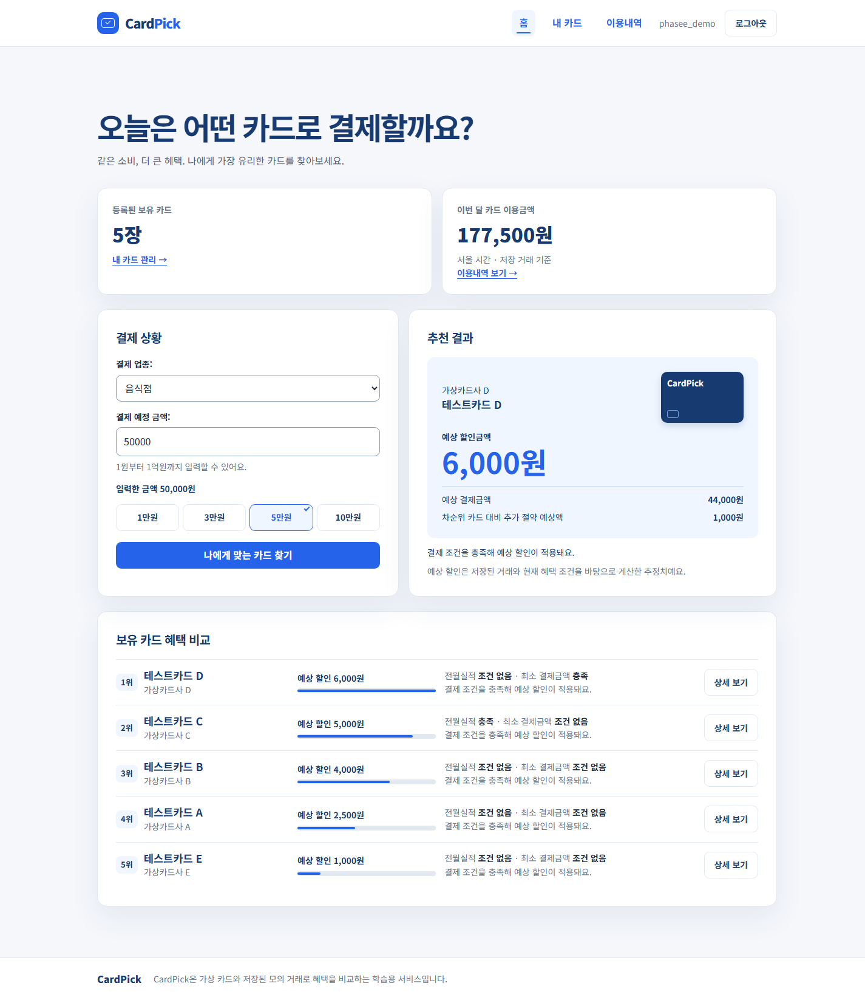

# CardPick | 카드픽

**같은 소비, 더 큰 혜택**

CardPick은 보유 카드의 할인 혜택, 전월실적, 결제금액과 한도를 비교해 결제 상황에 맞는 카드를 추천하는 금융 웹 서비스입니다. **가상 카드 상품과 로컬 Mock API의 모의 거래를 사용하는 학습용 MVP**입니다.

여러 장의 카드를 가지고 있어도 결제할 때마다 유리한 카드를 판단하기 어렵습니다. 할인율이 높아도 전월실적과 최소 결제금액을 충족하지 못하거나 건별·월별 한도를 이미 사용했다면 예상 혜택이 달라집니다.

금융 도메인 모델링, Django 웹 개발, HTTP 연동과 JSON 검증, 할인 계산과 추천 구현, 자동·브라우저 검증, 설계부터 문서화까지의 개발 과정을 학습했습니다.

## 핵심 기능

| 기능 | 구현 내용 |
| --- | --- |
| 계정 및 접근 제어 | 회원가입, 로그인·로그아웃, 로그인 사용자 기준 카드·거래 접근 |
| 보유 카드 관리 | 등록, 목록·상세 조회, 거래가 없는 보유 카드 삭제 |
| 카드별 혜택과 실적 | 할인 조건, 전월·당월 이용금액, 추정 한도 사용량과 잔여 한도 |
| 결제 카드 추천 | 업종·금액별 예상 할인 비교, 예상 결제금액과 차순위 대비 추가 절약액 |
| 이용내역 | 월·카드 필터, 합계·건수, 카드별 이용금액 비교 |
| Mock 거래 수집 | Django 관리 명령으로 요청·검증 후 SQLite에 저장 |

## 주요 화면



[모바일 이용내역](docs/screenshots/mobile-transactions.png)에서 월·카드 필터와 합계를 확인할 수 있습니다. 로그인, 회원가입, 홈, 내 카드, 상세, PC 이용내역, 모바일 추천은 [화면 갤러리](docs/validation.md#화면-갤러리)에 모았습니다.

## 기술 스택

- **서버와 데이터** — Python 3.12.9, Django 6.1, Django ORM, SQLite
- **화면** — Django Template, HTML, CSS, JavaScript
- **API 연동과 환경변수** — Python `http.server`, `requests`, `python-dotenv`
- **의존성과 버전 관리** — `asgiref`, `certifi`, `charset-normalizer`, `idna`, `sqlparse`, `urllib3`, Windows용 `tzdata`, Git, GitHub. 고정 버전은 [requirements.txt](requirements.txt)에 있습니다.

## 서비스 구조와 추천 방식

웹 요청은 Django URL과 View로 들어오고, 인증 세션과 Form을 거칩니다. 추천 서비스는 로그인 사용자의 보유 카드별로 할인액을 추정합니다. Mock 거래 수집은 관리 명령에서 로컬 HTTP 요청을 보내고 JSON 응답을 검사해 저장합니다. [아키텍처·ERD·API 상세](docs/architecture.md)

추천은 결제 업종·전월실적·최소 결제금액을 확인하고, 할인율을 적용한 금액에 원 미만 절사와 건별·월별 한도를 적용합니다. 월별 집계는 서울 시간 기준이며 기준 시각 정각과 이후 거래는 제외합니다. 웹 입력 범위는 **1원~100,000,000원**입니다. 표시된 할인은 저장된 모의 거래와 현재 등록된 혜택으로 계산한 **추정값**입니다.

### 추천 시연

2026년 11월 고정 검증에서 C의 전월실적은 300,000원, E의 추정 월 할인 사용량은 9,000원입니다.

| 가상 카드 | 음식점 할인 조건 | 50,000원 결제 예상 할인 |
| --- | --- | ---: |
| A | 5% | 2,500원 |
| B | 8% | 4,000원 |
| C | 10%, 전월실적 300,000원 | 5,000원 |
| D | 12%, 최소 결제금액 20,000원 | **6,000원** |
| E | 15%, 건별 3,000원, 월 10,000원 | 1,000원 |

**테스트카드 D**를 추천합니다. 예상 결제금액은 **44,000원**, 차순위 대비 추가 절약 예상액은 **1,000원**입니다. 이 결과에는 위의 가상 거래 조건이 필요합니다. 시드 명령은 카드 상품과 혜택을 생성합니다.

## Windows에서 실행

### 1. 저장소와 가상환경 준비

Windows PowerShell과 Python 3.12.9에서 검증했습니다.

```powershell
git clone https://github.com/Jiseolhye/card-recommendation.git
Set-Location card-recommendation
python --version
python -m venv .venv
.\.venv\Scripts\python.exe -m pip install -r requirements.txt
.\.venv\Scripts\python.exe -m pip check
```

`.\.venv\Scripts\Activate.ps1`로 활성화할 수 있습니다. 아래 명령은 가상환경의 Python 실행 파일을 직접 사용하므로 PowerShell 실행 정책을 변경할 필요가 없습니다.

### 2. 로컬 환경변수 설정

처음 실행하는 복사본에서 실행합니다. 이미 `.env`가 있으면 기존 파일을 유지하세요. 키는 생성 즉시 파일에 기록됩니다.

```powershell
Copy-Item -LiteralPath .env.example -Destination .env

@'
from pathlib import Path
from secrets import token_urlsafe

env = Path(".env")
text = env.read_text(encoding="utf-8")
env.write_text(text.replace("SECRET_KEY=\n", f"SECRET_KEY={token_urlsafe(50)}\n", 1), encoding="utf-8")
'@ | .\.venv\Scripts\python.exe -
```

### 3. DB 준비와 웹 서버 실행

```powershell
.\.venv\Scripts\python.exe manage.py migrate
.\.venv\Scripts\python.exe manage.py seed_mvp_cards
.\.venv\Scripts\python.exe manage.py runserver 127.0.0.1:8000 --noreload
```

브라우저에서 `http://127.0.0.1:8000/`으로 접속합니다. 가입하고 로그인한 뒤 **내 카드**에서 테스트카드 A를 등록합니다. **홈**에서 음식점과 50,000원을 입력합니다. A만 등록한 경우 예상 할인은 2,500원입니다. **이용내역**에서는 월·카드별 내역을 확인할 수 있습니다.

개발 서버는 로컬 개발용이며 운영 환경에 적합하지 않습니다. 서버를 종료하려면 해당 터미널에서 `Ctrl+C`를 누릅니다.

### 4. 선택 사항 — Mock 거래 가져오기

별도 로컬 실습 복사본의 새 DB를 사용합니다. 웹에서 실습 계정 `cardpick_demo`로 가입해 테스트카드 A를 등록합니다. `UserCard` ID는 카드 상품 ID와 별개로, 계정과 상품을 연결하는 보유 카드의 ID입니다.

프로젝트 루트의 새 PowerShell에서 환경변수를 파일에 설정하고 Mock 서버를 실행합니다.

```powershell
@'
from secrets import token_urlsafe
from dotenv import set_key

set_key(".env", "CARD_API_BASE_URL", "http://127.0.0.1:8765", quote_mode="never")
set_key(".env", "CARD_API_TOKEN", token_urlsafe(32), quote_mode="never")
'@ | .\.venv\Scripts\python.exe -

.\.venv\Scripts\python.exe scripts/mock_card_api.py
```

Mock 서버를 켠 채 같은 프로젝트 루트의 다른 PowerShell에서 보유 카드 ID를 확인하고 거래를 한 번 가져옵니다.

```powershell
@'
from cards.models import UserCard
print(list(UserCard.objects.filter(user__username="cardpick_demo").order_by("id").values_list("id", "card__name")))
'@ | .\.venv\Scripts\python.exe manage.py shell

$userCardId = Read-Host '테스트카드 A의 UserCard ID'
.\.venv\Scripts\python.exe manage.py import_card_transactions --username cardpick_demo --user-card-id $userCardId --card-id MOCK-CARD-A
```

성공하면 `저장 2건 (OTHER 0건)`이 표시됩니다. 원본 거래 날짜는 2026년 11월 1일입니다. 해당 월이 조회 가능한 시점에 **이용내역**에서 **2026년 11월**과 테스트카드 A를 선택하면 가상 식당과 가상 커피점의 거래 합계 27,500원을 확인할 수 있습니다. 홈·카드 상세·추천에는 각 기능의 월 구간에 해당하는 거래가 반영됩니다. 동일 거래를 다시 가져오면 중복 저장될 수 있습니다.

## 프로젝트 구조

```text
.
├── config/                         Django 설정과 프로젝트 URL
├── cards/
│   ├── models.py                   카드·보유 카드·혜택·거래 모델
│   ├── migrations/                 초기 스키마와 제약
│   ├── forms.py                    웹 입력 검증
│   ├── urls.py                     웹 경로
│   ├── views.py                    요청 처리와 사용자별 조회
│   ├── benefit_calculation.py      할인·월 경계·한도 계산
│   ├── benefit_service.py          거래 집계·카드별 할인 추정
│   ├── recommendation_service.py  보유 카드 비교·추천
│   ├── transaction_import.py       Mock 요청·응답 검증·저장
│   ├── management/commands/        카드 시드·거래 가져오기
│   ├── templates/                  Django 화면
│   ├── static/                     CSS·JavaScript·아이콘
│   ├── tests.py                    모델 테스트
│   └── test_*.py                   시드·API·추천·웹 기능 테스트
├── scripts/mock_card_api.py         로컬 모의 거래 서버
├── docs/                           아키텍처·검증 기록·화면
├── requirements.txt                고정 의존성
├── .env.example                    로컬 환경변수 이름
└── AGENTS.md                       프로젝트 작업 원칙
```

## 테스트와 검증

```powershell
.\.venv\Scripts\python.exe manage.py check
.\.venv\Scripts\python.exe manage.py makemigrations --check --dry-run
.\.venv\Scripts\python.exe manage.py test -v 2
```

자동 테스트 **136개 통과**, Django 시스템 검사 **0건**, 마이그레이션 변경 **없음**을 확인했습니다. 격리 환경에서 신규 사용자 흐름, 실제 로컬 Mock HTTP, 사용자별 데이터 격리, 요청 보호와 롤백을 검증했습니다. Chrome에서 5개 폭에 걸쳐 총 55개 화면 조합을 점검하고, 색상에만 의존하던 선택 표시를 보완한 뒤 회귀 검증했습니다. [검증 범위·성능 측정·미실행 항목](docs/validation.md)

## 현재 한계와 개선 방향

- 가상 카드와 로컬 Mock API를 사용합니다. 할인은 추정값이며 실제 카드사 API, 취소·환불, 카드사별 복잡한 혜택 조건은 지원 범위 밖입니다.
- 외부 거래 고유 식별자가 없어 동일 거래를 다시 가져오면 중복될 수 있습니다. 향후 외부 식별자와 유일성 제약을 검토할 수 있습니다.
- 추천의 카드별 반복 조회와 이용내역 전체 렌더링은 일괄 조회와 페이지네이션으로 개선할 수 있습니다.
- 가입 폼은 유니코드 대소문자 차이를 검사합니다. 동시 등록을 보장하는 대소문자 무시 유일성 제약은 DB에 없습니다.
- 실제 모바일 기기와 스크린리더, 운영 배포와 운영 보안은 검증 범위에 포함되지 않았습니다.

## 개발 과정과 AI 활용

| 주차 | 작업 |
| --- | --- |
| 1 | Windows 개발환경, Django 프로젝트, 환경변수 구성 |
| 2 | 카드·혜택·소유권·거래 모델과 마이그레이션 |
| 3 | 가상 카드 시드와 모델 검증 |
| 4 | 로컬 Mock API, 인증, 거래 가져오기 |
| 5 | 서울 월 경계, 이용실적, 한도와 할인 추정 |
| 6 | 보유 카드 비교와 추천 |
| 7 | 웹 화면 통합, 접근성 보완, 문서화와 실행 재현 |

사용자가 요구사항을 정의하고 단계별 작업 범위를 승인했으며, 결과를 검토했습니다. Codex를 코드 구현, 자동·브라우저 검증, 문서 작성에 활용했습니다.
