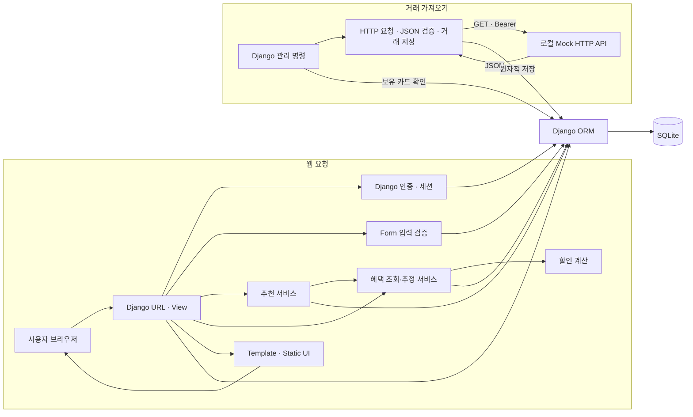
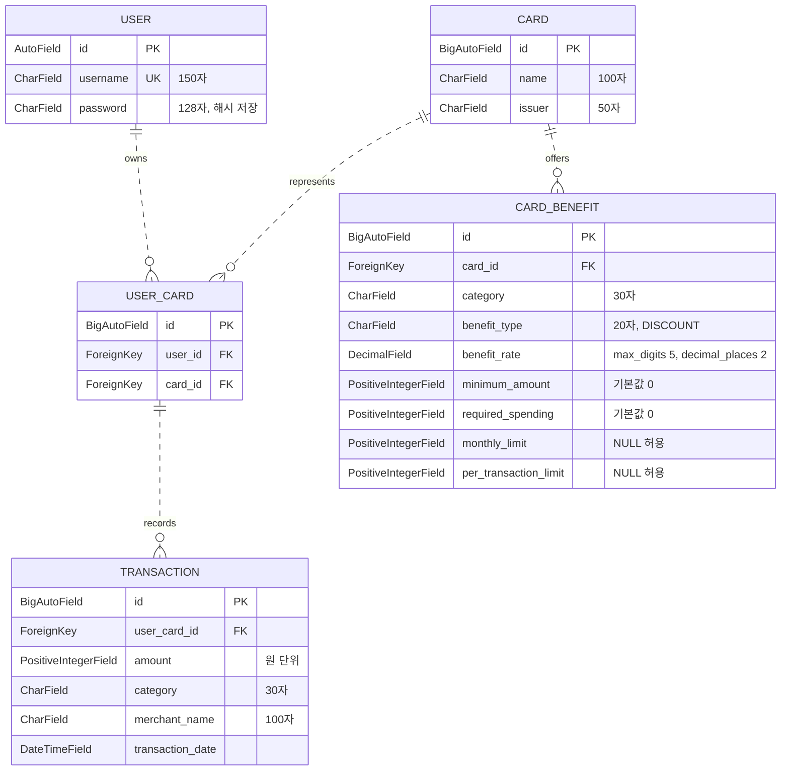

# 아키텍처와 데이터 모델

[README로 돌아가기](../README.md) · [검증 기록](validation.md)

## 서비스 구조



`config/urls.py`가 `cards/urls.py`를 연결합니다. `/login/`과 `/signup/`에서 계정을 사용하고, `/`의 GET은 홈을 표시하며 POST는 추천을 계산합니다. `/cards/`와 `/cards/<pk>/`는 보유 카드 목록·상세, `/transactions/`는 이용내역입니다. 등록·삭제·로그아웃에는 POST를 사용하며, 개인 화면은 세션의 `request.user`로 범위를 제한합니다. 추천 요청은 거래를 생성하지 않습니다.

## 데이터베이스 ERD



`USER`는 Django 기본 User의 관련 필드만 표시한 축약입니다. 외래 키는 모델에 `user`, `card`, `user_card`로 선언하며, DB 칼럼과 ORM의 ID 속성은 `_id`로 끝납니다. 카드 상품은 여러 계정에서 공유할 수 있고, 개별 거래는 각 계정의 `UserCard`에 연결됩니다.

| 모델 | 제약과 삭제 동작 |
| --- | --- |
| `UserCard` | `(user, card)` 유일성. 사용자 삭제는 보유 카드로 전파되며, 보유 카드가 참조하는 카드 상품은 보호됩니다. |
| `CardBenefit` | `(card, category, benefit_type)` 유일성. 카드 상품이 삭제되면 혜택도 삭제됩니다. 모델 검증은 할인율 0.01~100.00%를 허용하고, DB는 `0 < benefit_rate <= 100`을 확인합니다. |
| `CardBenefit` 금액 | 최소 결제금액·전월실적은 0 이상입니다. 건별·월별 한도는 양의 원 단위 정수 또는 `NULL`입니다. `NULL`은 해당 한도가 없음을 뜻합니다. |
| `Transaction` | 금액은 양의 정수이며 DB에서 `amount > 0`을 확인합니다. 거래가 연결된 `UserCard` 삭제는 `PROTECT`가 막습니다. 같은 보호가 연쇄 삭제에도 적용됩니다. |

스키마의 근거는 [모델](../cards/models.py)과 [초기 마이그레이션](../cards/migrations/0001_initial.py)입니다.

## 추천 계산과 서비스 계약

1. `PaymentForm`은 등록된 업종과 1~100,000,000원 범위의 숫자 문자열을 검증합니다. View는 세션 사용자의 PK와 하나의 기준 시각을 `recommend_best_card`에 전달합니다.
2. 추천 서비스가 로그인 사용자의 보유 카드들을 조회합니다. 카드별 `estimate_card_discount`는 소유권을 다시 확인하고, 저장 거래의 원금으로 전월·당월 이용금액을 집계합니다. 전월실적 집계에는 해당 카드의 모든 업종이 포함됩니다.
3. 카드 상품의 선택 업종 할인 혜택을 찾습니다. 월 한도가 있으면 당월 같은 업종의 거래를 `(거래 시각, 거래 ID)` 오름차순으로 재계산합니다. 각 거래에 현재 혜택 조건과 동일한 전월실적을 적용합니다. 건별·월별 한도 안에서 실제로 적용된 추정액만 누적하고, 한도를 채우면 재계산을 끝냅니다. 한도가 없으면 사용량·잔여 한도는 `None`입니다.
4. `calculate_discount`는 혜택 불일치, 전월실적 미달, 최소 결제금액 미달 순으로 검사해 해당하면 0원을 반환합니다. 통과하면 `금액 × 할인율 ÷ 100`을 `Decimal`로 계산하고, 원 미만 절사, 건별 한도, 월 잔여 한도를 순서대로 적용합니다. 월 잔여 한도는 `max(0, 월 한도 - 추정 사용량)`입니다.
5. 예상 할인액 내림차순, `UserCard.id` 오름차순으로 정렬합니다. 최고 할인액이 양수면 첫 카드를 대표로 추천합니다. 최고가 동률이면 공동 1위를 표시하고 차액은 0원입니다. 카드가 없거나 모든 할인액이 0원이면 추천 없이 반환하고, 비교할 수 있는 카드는 결과에 남습니다. 한 장만 보유하면 차순위 차액은 `None`입니다. 추천 결과에는 입력 금액에서 예상 할인을 뺀 예상 결제금액이 표시됩니다.

- **시간 기준** — `Asia/Seoul` 월 경계를 UTC로 변환해 조회합니다. 전월은 `[전월 1일 00:00, 당월 1일 00:00)`, 당월 집계와 할인 사용량은 `[당월 1일 00:00, 기준 시각)`입니다. 기준 시각 정각과 미래 거래는 제외됩니다. 월이 바뀌면 전월실적 기준이 이동하고, 월 한도 사용량은 새 달의 거래로 다시 계산합니다.
- **서비스 입력** — `estimate_card_discount`와 `recommend_best_card`는 키워드 인자로 사용자 ID, 양의 Python `int` 금액, `Category` 값, 시간대가 있는 `datetime`을 받습니다. 카드별 추정에는 `user_card_id`가 추가됩니다. 1억원 상한은 웹 Form 정책입니다. 잘못된 결제 입력은 `ValueError`, 소유권 불일치나 누락 카드는 카드별 서비스에서 `UserCard.DoesNotExist`입니다. 카드별 계산 예외가 발생하면 추천 서비스는 오류를 전달합니다.
- **0원 사유** — 조건을 통과한 뒤 계산 결과가 0원이면 월 한도 소진, 건별 한도 0, 원 단위 절사 순으로 사유를 선택합니다. 건별 한도 0은 순수 계산 함수가 처리하는 경계이며 저장 모델의 한도는 양수 또는 `NULL`입니다.

## Mock API와 저장 흐름

`scripts/mock_card_api.py`는 `127.0.0.1:8765`에서 동작합니다. `GET /cards/MOCK-CARD-A/transactions`는 요청 본문 없이 `Authorization: Bearer <실습용 토큰>` 헤더를 받습니다. 접속 주소와 토큰은 `CARD_API_BASE_URL` 및 `CARD_API_TOKEN`으로 설정합니다. 정상 인증은 `200`, 토큰 누락·불일치는 `401`, 정상 토큰으로 지원하지 않는 경로를 호출하면 `404`입니다.

```json
{
  "card_id": "MOCK-CARD-A",
  "currency": "KRW",
  "transactions": [
    {
      "amount": 23000,
      "merchant_name": "가상 식당",
      "merchant_category": "일반음식점",
      "transaction_date": "2026-11-01T00:10:00+09:00"
    },
    {
      "amount": 4500,
      "merchant_name": "가상 커피점",
      "merchant_category": "커피전문점",
      "transaction_date": "2026-11-01T09:20:00+09:00"
    }
  ]
}
```

1. 관리 명령이 `--username`과 `--user-card-id`를 함께 조회해 소유권을 확인합니다. `--card-id`는 Mock API의 카드 식별자입니다.
2. 클라이언트는 포트가 지정된 루프백 HTTP 주소로 요청합니다. 연결은 2초, 읽기는 5초로 제한하며 리다이렉트는 따라가지 않습니다. 인증·연결·타임아웃·HTTP 상태·JSON 오류는 관리 명령 오류로 전달합니다.
3. 응답 객체의 카드 ID, `KRW` 통화, 거래 배열을 검사합니다. 각 행은 양의 정수 금액, 1~100자 가맹점명, 비어 있지 않은 업종, 오프셋이 있는 ISO 8601 거래 시각을 검증합니다. 일반음식점·커피전문점·대형할인점은 `FOOD`·`CAFE`·`MART`로, 나머지 비어 있지 않은 업종은 `OTHER`로 매핑합니다. 거래 시각은 UTC로 변환해 저장하고 웹에서는 서울 시간으로 표시합니다.
4. `transaction.atomic()`에서 모든 행의 모델 검증을 마친 뒤 저장합니다. 행이 유효하지 않거나 DB 오류가 발생하면 해당 배치는 반영되지 않습니다. 저장 거래는 월별 이용내역, 카드 상세 실적, 추천 계산에서 조회합니다. 외부 거래 고유 ID가 없어 재수집 시 중복될 수 있습니다.

[Windows Mock 실행 절차](../README.md#4-선택-사항--mock-거래-가져오기) · [가져오기 서비스](../cards/transaction_import.py)

다이어그램 표기법을 확인할 수 있습니다. [Mermaid 흐름도](https://mermaid.js.org/syntax/flowchart.html) · [Mermaid ERD](https://mermaid.js.org/syntax/entityRelationshipDiagram.html)
